# PyTorch/XLA & OpenXLA on Cloud TPU Playbook (`pytorch-xla-tpu-playbook`)

- **Por qué es relevante:** Permite llevar modelos existentes de PyTorch a Cloud TPU y OpenXLA sin reescribir el proyecto desde cero, eliminando las trampas de recompilación y sincronización que degradan el rendimiento en aceleradores XLA.
- **Para quién es:** Ingenieros de Machine Learning y sistemas que entrenan o sirven modelos en PyTorch y necesitan escalar cargas en Cloud TPU v5e o intercalar kernels compilados de JAX dentro de `torch.autograd`.
- **Quién debería verlo:** Equipos con código en producción sobre `torch.nn.Module` que evalúan TPUs en Google Cloud o buscan interoperabilidad zero-copy entre PyTorch y JAX mediante DLPack.
- **Parte de la serie:** [JAX, OpenXLA & Cloud TPU Field Guide](https://github.com/ykro/jax-openxla-field-guide)

---

## Arquitectura y Flujo en OpenXLA

### 1. Acumulación en `LazyTensor` y Barrera Explícita `mark_step()`

En lugar de enviar cada operación individualmente como ocurre en el modo eager de CUDA, PyTorch/XLA acumula operaciones en un grafo intermedio (`LazyTensor` IR) y corta el grafo únicamente al encontrar `xm.mark_step()` o una lectura síncrona hacia el host (`.item()`).



### 2. Eliminando las 3 Trampas Clásicas de XLA

El traslado directo de un ciclo de entrenamiento de GPU a TPU suele sufrir tres cuellos de botella silenciosos, a saber, lecturas `.item()` a mitad del paso, indexación booleana dinámica `h[h > 0]` que cae a CPU mediante `aten::nonzero` y longitudes de secuencia variables sin padding estático.



### 3. Puente Zero-Copy entre PyTorch `autograd` y `@jax.jit`

Cuando un bloque crítico se beneficia de fusión agresiva en XLA (por ejemplo, `RMSNorm + SwiGLU`), es posible envolver un kernel `@jax.jit` y su gradiente `jax.vjp` dentro de un `torch.autograd.Function` transfiriendo punteros de memoria sin copia vía `torch.utils.dlpack` y `jax.dlpack`.



---

## Experimentos Incluidos

| Script | Qué demuestra | Resultado Verificado |
|---|---|---|
| `experiments/01_lazy_tensor_5_lines.py` | Migrar un ciclo de entrenamiento PyTorch a `xla_device()` con `mark_step()` y `add_step_closure()`. | `UncachedCompile=1`, `CachedCompile=5`, `HostStalls=0`, pérdida baja de `0.999990` a `0.946505`. |
| `experiments/02_hunting_graph_breaks.py` | Auditar un modelo PyTorch naive con `metrics_report()` para detectar graph breaks y fallbacks. | Detecta `10 UncachedCompile`, `10 HostStalls` y `5 aten::nonzero` en 5 pasos. |
| `experiments/03_three_xla_traps_fixed.py` | Corregir `.item()`, `h[h > 0]` y shapes variables con `add_step_closure`, `torch.where` y buckets estáticos. | Recompilaciones tras warmup bajan de `11` a `0`; `torch.allclose=True` (`max_abs_diff=2.98e-08`). |
| `experiments/04_spmd_sharding_tpu.py` | Particionado automático GSPMD (`Mesh(2, 2)` en ejes `data` y `model`) sobre 4 dispositivos OpenXLA. | Shards `[8, 32, 128]` y `[128, 256]`; paridad exacta `allclose=True` (`max_abs_diff=7.75e-07`). |
| `experiments/05_call_jax_from_pytorch.py` | Interoperabilidad zero-copy PyTorch ↔ JAX con DLPack, `@jax.jit` y `jax.vjp` dentro de `torch.autograd.Function`. | Paridad forward (`2.38e-07`) y backward (`2.91e-11`); entrenamiento con `AdamW` converge de `1.000893` a `0.892995`. |

---

## Onboarding y Ejecución Paso a Paso (Local y Cloud TPU v5e)

### 1. Instalación desde cero

```bash
git clone https://github.com/ykro/pytorch-xla-tpu-playbook.git
cd pytorch-xla-tpu-playbook
python3 -m venv .venv
source .venv/bin/activate
pip install --upgrade pip
pip install -e ".[dev]"
```

### 2. Recorrido guiado en orden (`01` a `05` + Juez Externo)

```bash
# Ejecutar cada experimento individualmente en orden progresivo
make exp01   # LazyTensor y barrera explícita mark_step() en 5 líneas
make exp02   # Diagnóstico de graph breaks y aten::nonzero con métricas XLA
make exp03   # Corrección de las 3 trampas clásicas de XLA (0 recompilaciones extra)
make exp04   # Particionado GSPMD 2D (data, model) sobre 4 dispositivos OpenXLA
make exp05   # Puente zero-copy PyTorch autograd <-> @jax.jit vía DLPack

# Ejecutar linter, suite pytest y el juez externo verify_playbook.py
make all
```

### 3. Ejecución on-demand en Cloud TPU v5e

Para aprovisionar una VM on-demand de Cloud TPU v5e (`v5litepod-4` con runtime `v2-alpha-tpuv5-lite`) en tu propio proyecto de Google Cloud (variable `PROJECT_ID`), correr la suite completa, descargar el reporte de métricas y destruir la TPU automáticamente al salir (`trap cleanup EXIT`), se incluye el script `gcp/run_tpu_pytorch_xla.sh`.

```bash
bash gcp/run_tpu_pytorch_xla.sh
```

---

## Salida Real de Verificación (`verify_playbook.py`)

```text
======================================================================
 PyTorch/XLA & OpenXLA TPU Playbook — Outside Judge Verification Suite
======================================================================
PyTorch Version : 2.15.0
JAX Version     : 0.12.0.1
OpenXLA Devices : ['cpu:0', 'cpu:1', 'cpu:2', 'cpu:3']
Platform        : macOS-26.6.2-arm64-arm-64bit

--- [1/5] Experiment 01: LazyTensor & mark_step() in 5 Lines ---
[Step 0] PendingIROps before barrier=134 | Pending after=0 | UncachedCompile=1 | CachedCompile=0 | Loss=0.999990
[Step 1] PendingIROps before barrier=122 | Pending after=0 | UncachedCompile=1 | CachedCompile=1 | Loss=0.993131
[Step 2] PendingIROps before barrier=122 | Pending after=0 | UncachedCompile=1 | CachedCompile=2 | Loss=0.984461
[Step 3] PendingIROps before barrier=122 | Pending after=0 | UncachedCompile=1 | CachedCompile=3 | Loss=0.973455
[Step 4] PendingIROps before barrier=122 | Pending after=0 | UncachedCompile=1 | CachedCompile=4 | Loss=0.960258
[Step 5] PendingIROps before barrier=122 | Pending after=0 | UncachedCompile=1 | CachedCompile=5 | Loss=0.946505

--- [2/5] Experiment 02: Hunting Graph Breaks with XLA Metrics ---
[Naive Step 0 | seq_len=19] loss=0.12489 | UncachedCompile=2 | HostStalls=2 | AtenNonzero=1
[Naive Step 1 | seq_len=27] loss=0.06406 | UncachedCompile=4 | HostStalls=4 | AtenNonzero=2
[Naive Step 2 | seq_len=33] loss=-0.02248 | UncachedCompile=6 | HostStalls=6 | AtenNonzero=3
[Naive Step 3 | seq_len=41] loss=-0.07806 | UncachedCompile=8 | HostStalls=8 | AtenNonzero=4
[Naive Step 4 | seq_len=52] loss=-0.16739 | UncachedCompile=10 | HostStalls=10 | AtenNonzero=5

--- [3/5] Experiment 03: Fixing the 3 Classic XLA Traps ---
[Trap Fix Summary] Naive UncachedCompile=12 -> Optimized UncachedCompile=1 (Recompiles after warmup=0)
[Trap Fix Summary] Naive HostStalls=12 -> Optimized HostStalls=0
[Trap Fix Summary] Naive AtenNonzero=12 -> Optimized AtenNonzero=0
[Trap Fix Summary] Numerical Parity allclose=True (max_abs_diff=2.98e-08)

--- [4/5] Experiment 04: OpenXLA GSPMD Sharding Across 4 Devices ---
OpenXLA Devices Visible : 4 (['cpu:0', 'cpu:1', 'cpu:2', 'cpu:3'])
GSPMD Mesh Shape        : data=2, model=2
Input x Global -> Shard : [16, 32, 128] -> [8, 32, 128] P('data', None, None)
w_up Global    -> Shard : [128, 512] -> [128, 256] P(None, 'model')
w_down Global  -> Shard : [512, 128] -> [256, 128] P('model', None)
SPMD Parity allclose    : True (max_abs_diff=7.75e-07)

--- [5/5] Experiment 05: Zero-Copy PyTorch <-> JAX Autograd Bridge ---
[Hybrid PyTorch+JAX Step 0] loss=1.000893
[Hybrid PyTorch+JAX Step 1] loss=0.985589
[Hybrid PyTorch+JAX Step 2] loss=0.965895
[Hybrid PyTorch+JAX Step 3] loss=0.936393
[Hybrid PyTorch+JAX Step 4] loss=0.892995

Forward Parity allclose : True (max_abs_diff=2.38e-07)
Backward Parity allclose: True (grad_x_diff=2.91e-11, grad_w_gate_diff=5.82e-11)

======================================================================
 ALL OUTSIDE JUDGE VERIFICATIONS PASSED (0 RECOMPILES AFTER WARMUP)   
======================================================================
```
