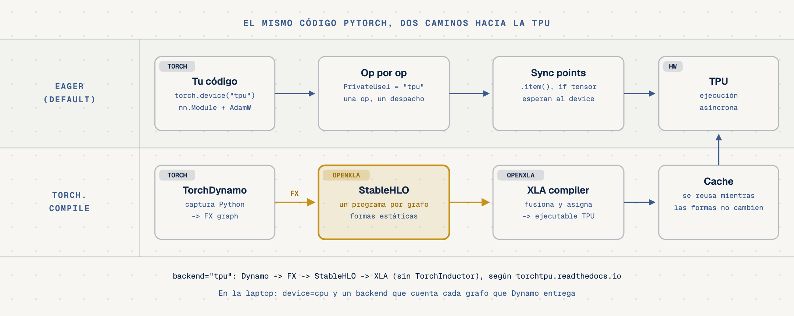
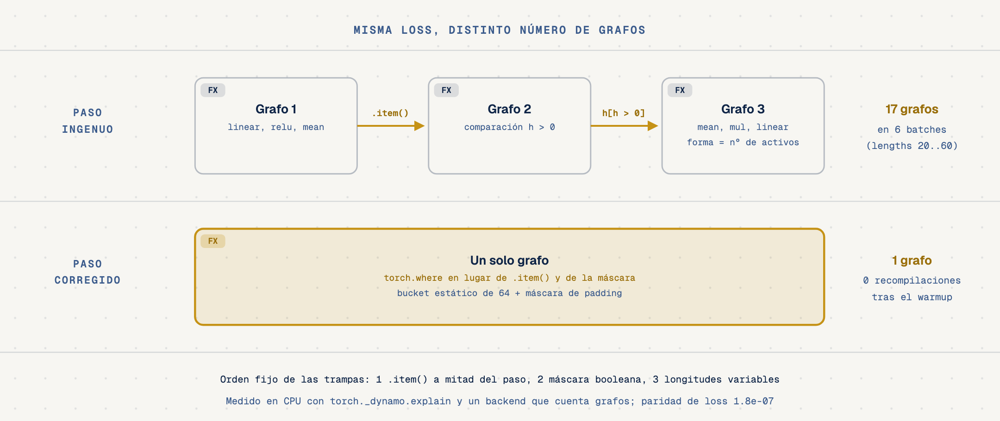
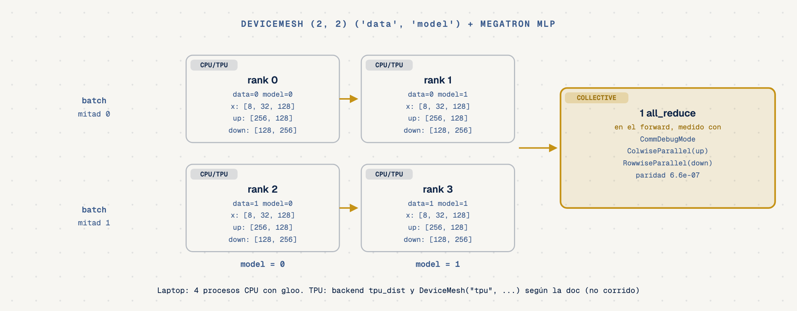
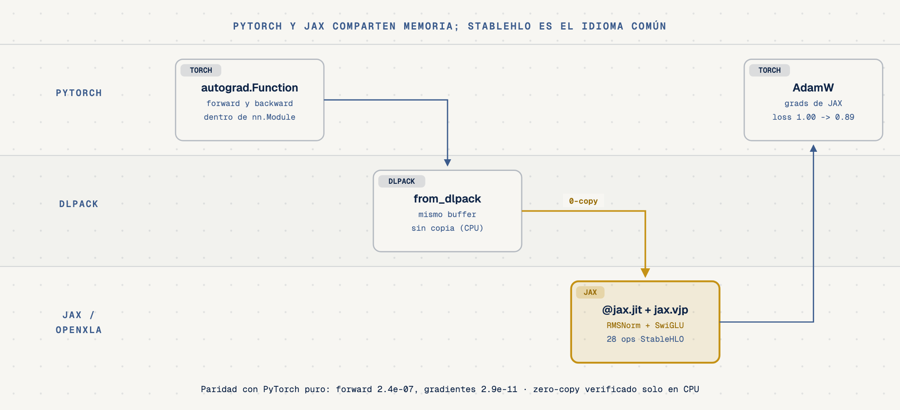

# TorchTPU Playbook, PyTorch nativo en Cloud TPU (`torchtpu-playbook`)

- **Por qué es relevante:** desde 2026 la forma oficial de correr PyTorch en Cloud TPU es [TorchTPU](https://github.com/google-pytorch/torch_tpu), un backend nativo de PyTorch (`torch.device("tpu")`, `torch.compile(backend="tpu")`, `torch.distributed` con `tpu_dist`). Tu código PyTorch se queda como está. Lo que decide si una TPU rinde es que el paso de entrenamiento se pueda compilar como un grafo estable, con formas estáticas y sin viajes al host a mitad del paso.
- **Para quién es:** ingenieros que entrenan o sirven modelos en PyTorch y evalúan Cloud TPU, o que quieren mezclar un kernel de JAX dentro de `torch.autograd`.
- **Qué vas a aprender:** los dos modos de TorchTPU (eager y `torch.compile`), cómo cazar graph breaks con `torch._dynamo.explain`, las tres trampas que obligan a recompilar y cómo se corrigen, sharding declarado con `DeviceMesh` + DTensor, y el puente PyTorch y JAX con DLPack sobre StableHLO, el idioma común de OpenXLA.
- **Parte de la serie:** [JAX & OpenXLA Field Guide](https://github.com/ykro/jax-openxla-field-guide) (quinto episodio, cierre de la ruta para quien viene de PyTorch).

> **Antecedente.** Este repo se llamaba `pytorch-xla-tpu-playbook` y usaba PyTorch/XLA (`torch_xla`). Ese proyecto está deprecado y su repo se archiva el 15 de noviembre de 2026; el banner de [github.com/pytorch/xla](https://github.com/pytorch/xla) pide empezar con TorchTPU y migrar. Aquí ya no queda código de `torch_xla`.

---

## Qué es TorchTPU (fuentes primarias)

| Tema | Lo que dice la documentación | Fuente |
|---|---|---|
| Qué es | Backend de PyTorch fuera del árbol, registrado como `PrivateUse1` y renombrado a `tpu`; código abierto (Apache 2.0) por Google y el equipo de PyTorch de Meta. Reemplaza a PyTorch/XLA. | [docs.cloud.google.com/tpu/docs/pytorch-on-tpu](https://docs.cloud.google.com/tpu/docs/pytorch-on-tpu), [How TorchTPU works](https://torchtpu.readthedocs.io/en/latest/how_torchtpu_works/) |
| Instalación | `pip install torch_tpu==0.2.0 --extra-index-url https://download.pytorch.org/whl/cpu`, Python 3.11+. En PyPI solo hay wheels `manylinux_2_31_x86_64`: no se instala en macOS. | [README de torch_tpu](https://github.com/google-pytorch/torch_tpu), [PyPI](https://pypi.org/project/torch-tpu/) |
| Eager | Modo por defecto (strict eager). `TORCH_TPU_LAUNCH_BLOCKING=1` para depurar y `TORCH_TPU_DEFER_AND_FUSE=1` para fusionar secuencias de ops. | [Execution model](https://torchtpu.readthedocs.io/en/latest/torchtpu_execution_model/) |
| Compilado | `torch.compile(model, backend="tpu")`: TorchDynamo entrega un grafo FX, el backend genera un programa StableHLO y XLA lo compila (no usa TorchInductor). Cache de ejecutables en tres niveles. | [How TorchTPU works](https://torchtpu.readthedocs.io/en/latest/how_torchtpu_works/) |
| Formas dinámicas | Bounded dynamism con buckets (`mark_dynamic(..., min=..., max=...)`, `bucket_size`); `dynamic=True` no está soportado; ops como `torch.nonzero` no están soportadas para formas dinámicas. | [Dynamic shapes](https://torchtpu.readthedocs.io/en/latest/dynamic_shapes/) |
| Sincronizaciones | `if my_tensor.all()` o `torch.masked_select` fuerzan una sincronización y, en modo compilado, un graph break. | [Execution model](https://torchtpu.readthedocs.io/en/latest/torchtpu_execution_model/) |
| Distribuido | Process group `tpu_dist`; DDP, FSDP2 y DTensor; `DeviceMesh("tpu", ...)` y `torch.tpu.distributed.topology_aware_mesh`. | [Distributed support](https://torchtpu.readthedocs.io/en/latest/distributed_support/) |
| Estado | Versión pública 0.2.0. La tabla de features marca como Validated v5e, v5p, v6e y v7, y como Experimental FSDPv2 y SymInts, entre otros. | [Feature set](https://torchtpu.readthedocs.io/en/latest/feature_set/) |

No hay mención de DLPack ni de interoperabilidad con JAX en la documentación de TorchTPU; por eso el experimento 05 solo afirma lo que corre en CPU.

---

## Arquitectura



El camino compilado es el que importa para rendimiento: Dynamo convierte tu función en un grafo FX y el backend lo baja a StableHLO. Si el grafo se parte o cambia de forma en cada paso, el compilador trabaja de nuevo.







---

## Experimentos

| Script | Qué demuestra | Resultado medido (CPU) |
|---|---|---|
| `experiments/01_eager_then_compile.py` | El mismo paso de entrenamiento, eager y con `torch.compile`, desde los mismos pesos. | 1 grafo para 6 pasos (5 reutilizaciones); losses eager y compilado idénticas (diferencia 0); la loss baja de `0.849` a `0.571`. |
| `experiments/02_hunting_graph_breaks.py` | Un paso que parece inofensivo, auditado con `torch._dynamo.explain`. | 3 grafos y 2 graph breaks por llamada: `.item()` y la máscara `h[h > 0]` (`aten::nonzero`). 11 grafos en 5 pasos: el grafo de después de la máscara recibe un tamaño distinto en cada paso. |
| `experiments/03_three_traps_fixed.py` | Las tres trampas corregidas en orden: `.item()`, máscara booleana, longitudes variables. | Ingenuo: 17 grafos en 6 batches de longitudes 20 a 60. Corregido: 1 grafo, 0 breaks, 0 recompilaciones tras el warmup; misma loss (`max diff 1.8e-07`). Costo: el batch de 20 se procesa con 64 posiciones (3.2x). |
| `experiments/04_dtensor_mesh_sharding.py` | `DeviceMesh` (2, 2) `('data', 'model')` con un MLP estilo Megatron (`ColwiseParallel` + `RowwiseParallel`). | 4 procesos CPU con `gloo`; cada rank guarda la mitad de cada matriz (`[256, 128]` y `[128, 256]`); `CommDebugMode` cuenta 1 `all_reduce` en el forward; paridad con el modelo sin particionar `6.6e-07`. |
| `experiments/05_torch_jax_dlpack_stablehlo.py` | Un kernel `@jax.jit` + `jax.vjp` dentro de `torch.autograd.Function` vía DLPack, y su módulo StableHLO. | Mismo buffer en ambos sentidos (CPU); paridad forward `2.4e-07` y gradientes `2.9e-11`; 5 pasos de AdamW de `1.0009` a `0.8930`; el módulo StableHLO tiene 28 ops y 2 `dot_general`. |

Juez externo: `verify_torchtpu_playbook.py` corre los cinco experimentos, verifica 20 invariantes y escribe `benchmarks/latest_results.json` y `benchmarks/terminal_output.txt`.

### Cómo leer estas cifras

- **Backend honesto.** En la laptop `torch_tpu` no se puede instalar (solo hay wheels para Linux x86_64). Los experimentos detectan eso y usan `device=cpu` y un backend de `torch.compile` propio, `GraphRecorder`, que registra cada grafo FX que Dynamo le entrega y lo ejecuta con PyTorch en eager. El JSON lo dice en `environment.compile_backend`.
- **Qué cuenta y qué no.** Las cifras de grafos, graph breaks y recompilaciones salen de TorchDynamo, la misma pieza que usa `torch.compile(backend="tpu")` antes de llegar a StableHLO. Son conteos reales de PyTorch. Lo que no se mide es lo que pasa después: cuánto tarda XLA en compilar, cuánto tarda la TPU en ejecutar o qué hace TorchTPU en modo eager con estas trampas.
- **Cero tiempos.** El repo no reporta milisegundos. En CPU con un backend eager, el tiempo no dice nada de una TPU.
- **`dynamic=False` a propósito.** Se compila con formas estáticas, que es lo que XLA espera. TorchTPU ofrece además bounded dynamism con buckets; no se probó aquí y el bucket manual del experimento 03 es la versión portable de la misma idea.
- **Sharding en CPU.** El experimento 04 usa `torch.distributed` con `gloo` y 4 procesos. En una TPU el cambio documentado es `backend="tpu_dist"` y `DeviceMesh("tpu", ...)`; ese camino está en el script de GCP y no se corrió.
- **Zero-copy solo en CPU.** La comparación de punteros del experimento 05 se hizo con tensores contiguos de CPU. No se verificó DLPack entre tensores de `torch_tpu` y JAX en una TPU.
- **Datos de juguete.** Modelos de dos capas y datos aleatorios con semilla fija: las cifras son deterministas y sirven para ver el mecanismo, no la calidad de un modelo.

---

## Cómo correrlo

```bash
git clone https://github.com/ykro/torchtpu-playbook.git
cd torchtpu-playbook
python3 -m venv .venv && source .venv/bin/activate
pip install -e ".[dev]"
make all        # ruff + pytest + juez externo
make exp03      # o cualquier experimento suelto
```

### En una Cloud TPU v6e (no corrido)

`gcp/run_torchtpu_v6e.sh` crea una TPU VM `v6e-4` on-demand, instala `torch_tpu==0.2.0`, corre los experimentos 01 a 04 con `device=tpu` y borra la VM al salir (`trap cleanup EXIT`). Necesita `PROJECT_ID`. Se escribió a partir de la documentación de TorchTPU y todavía no se ejecutó; ninguna cifra de este README viene de una TPU.

```bash
PROJECT_ID=tu-proyecto ./gcp/run_torchtpu_v6e.sh
```

---

## Estructura

```text
experiments/
  tpu_backend.py                    # device, backend y GraphRecorder
  01_eager_then_compile.py
  02_hunting_graph_breaks.py
  03_three_traps_fixed.py
  04_dtensor_mesh_sharding.py
  05_torch_jax_dlpack_stablehlo.py
tests/test_torchtpu_playbook.py
verify_torchtpu_playbook.py         # juez externo
benchmarks/                         # salida del juez (CPU)
diagrams/                           # fuentes HTML + SVG + PNG
gcp/run_torchtpu_v6e.sh             # TPU on-demand con auto-teardown (no corrido)
```

Entorno de la corrida publicada: PyTorch 2.15.0, JAX 0.12.0.1, Python 3.12, macOS arm64, CPU.
